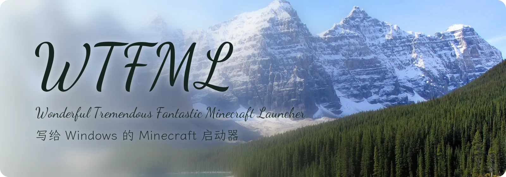
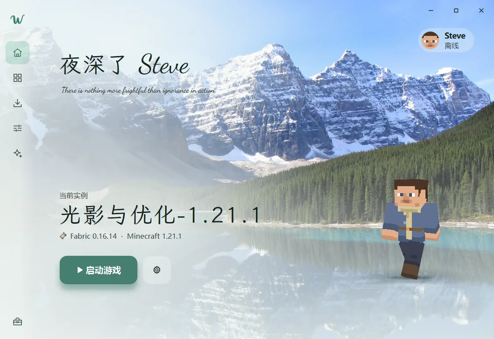
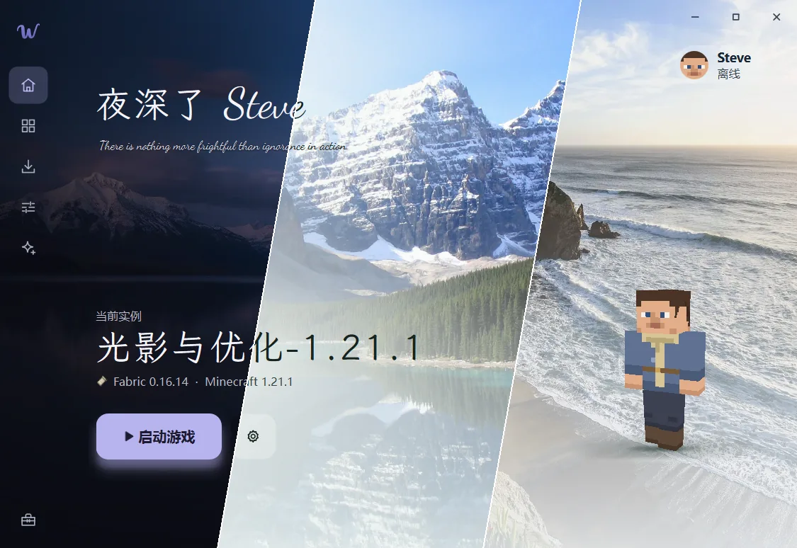
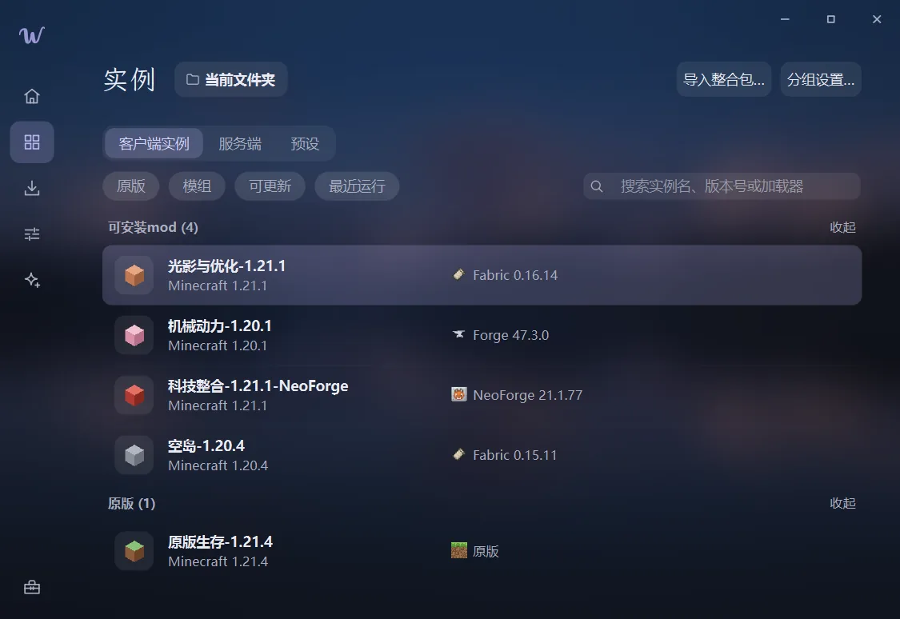
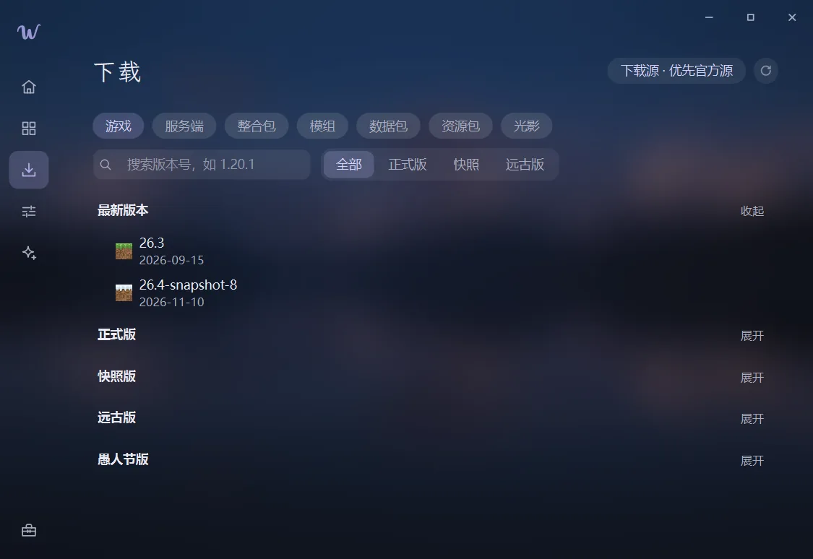
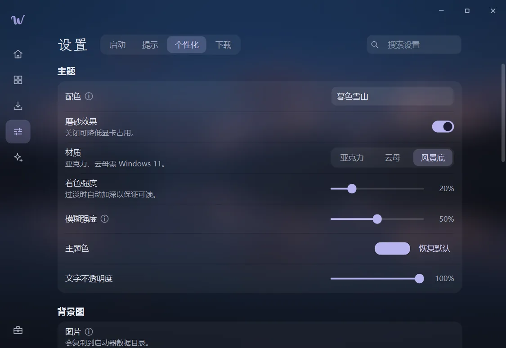
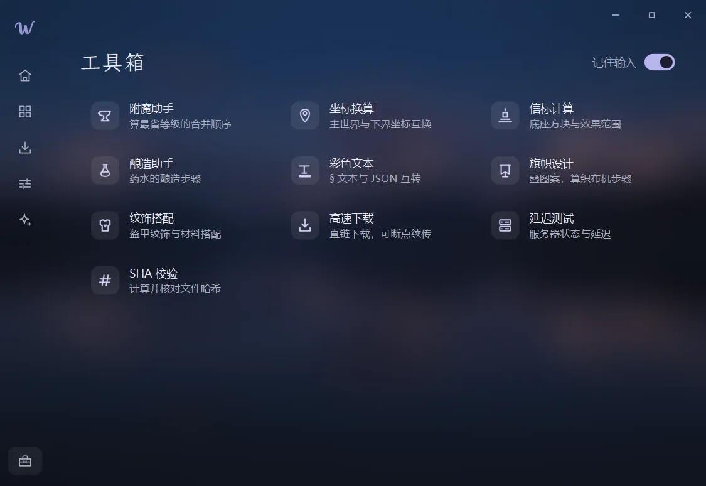
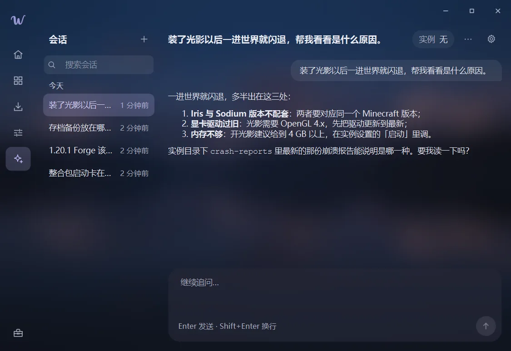

  <picture>
    <source media="(prefers-color-scheme: dark)" srcset="assets/readme/hero-dark.webp">
    
  </picture>

  <a href="https://github.com/0x7fffff/WTFML/releases/latest">
    <picture>
      <source media="(prefers-color-scheme: dark)" srcset="assets/readme/download-dark.svg">
      
    </picture>
  </a>

单文件 exe，下载即用，不用安装。支持 Windows x64。

 

WTFML 是一个用 C++ 和 Qt 写的 Minecraft 启动器。整窗铺一张风景，导航和面板是一层磨砂玻璃；安装游戏、管理实例、导入整合包、开服务端，都在这一扇窗里完成。

 

## <picture><source media="(prefers-color-scheme: dark)" srcset="assets/readme/h-home-dark.svg"></picture>

打开先是一片风景。左上角一句问候，下面一行每日一言，中文用霞鹜文楷，英文用 Dancing Script。当前实例默认是上次启动的那一个，点一下就进游戏；右上角是账号，皮肤立在一旁。

  <picture>
    <source media="(prefers-color-scheme: dark)" srcset="assets/readme/shot-home-dark.webp">
    
  </picture>

## <picture><source media="(prefers-color-scheme: dark)" srcset="assets/readme/h-themes-dark.svg"></picture>

暮色雪山、冰川碧湖、落日海崖，每一套带着自己的风景和主题色，也可以跟随系统的深浅色。磨砂的底默认是模糊过的风景，在 Windows 11 上也可以换成系统的亚克力或云母。主题色、文字不透明度、背景图都能换，细到某个区域、某类控件的颜色也能单独调。

  

## <picture><source media="(prefers-color-scheme: dark)" srcset="assets/readme/h-library-dark.svg"></picture>

可以挂多个游戏文件夹，实例能分组、收藏、改名、换图标、复制或移动，改名不会丢掉分组和启动记录。每个实例的设置页里管着模组、资源包、光影、数据包、存档和服务器列表，世界备份与整份快照也在这里。删除实例前要先确认，删掉的目录进回收站。

  

## <picture><source media="(prefers-color-scheme: dark)" srcset="assets/readme/h-downloads-dark.svg"></picture>

客户端支持原版、Fabric、Quilt、Forge、NeoForge，服务端另有 Paper、Purpur 和 Spigot。下载可以并发、限速、走代理、断点续传，已经有的文件先校验，能用就不再下。整合包认 ZIP、mrpack、CurseForge 导出包和 MultiMC / Prism 实例，装了 7-Zip 时也能直接导入 `.rar`、`.7z`。

  

## <picture><source media="(prefers-color-scheme: dark)" srcset="assets/readme/h-settings-dark.svg"></picture>

设置分启动、提示、个性化、下载四页，没有「应用」按钮，改完就存。缺的 Java 可以从 Adoptium 一键下好，也可以扫描本机已有的，或者手动指定一个 `java.exe`；内存可以手动给，也可以按物理内存自动分配。

  

## <picture><source media="(prefers-color-scheme: dark)" srcset="assets/readme/h-toolbox-dark.svg"></picture>

玩的时候常要算的东西放在一起：附魔顺序、彩色文本、坐标换算、服务器延迟、文件校验、信标、酿造、旗帜图案、直链下载，还有一个能拖着转的盔甲纹饰三维预览。

  

## <picture><source media="(prefers-color-scheme: dark)" srcset="assets/readme/h-agent-dark.svg"></picture>

接一个兼容 OpenAI 接口的模型，就能在启动器里聊天，让它读当前实例的日志和崩溃报告帮忙排查。它只碰锁定的那一个实例：改配置文件前每次都要你批准，改之前先备份；凭据文件和二进制文件一律不外发。API Key 存在 Windows 凭据管理器里。

  

 

## <picture><source media="(prefers-color-scheme: dark)" srcset="assets/readme/h-start-dark.svg"></picture>

1. 从 [Releases](https://github.com/0x7fffff/WTFML/releases/latest) 下载 exe，放在哪里都行，双击打开。
2. 第一次打开还没有实例，点主页的「下载游戏」，选一个版本和加载器装上。
3. 点右上角「登录」，用微软账号登录，或者填一个离线名字。
4. 回到主页，点「启动游戏」。

<b>常见问题</b>

 

**数据放在哪里**
放在当前选中的游戏文件夹里，和 exe 在哪无关。启动器自己的设置和账号表在注册表 `HKCU\Software\WTFML`，登录令牌用 Windows DPAPI 加密后才落盘。

**日志在哪里**
`<游戏文件夹>/logs/wtfml.log`，每次启动重写一份。游戏自己的输出在单独的日志窗口里，不进这份文件。

**能同时开两个窗口吗**
同一个游戏文件夹同时只能有一个启动器窗口，第二个会在打开前被拒绝；换一个游戏文件夹就可以。

**智能体的对话存在哪里**
`%LOCALAPPDATA%\WTFML\agent`，不跟着游戏文件夹走。每个会话可以单独选择用 DPAPI 加密存储。

<b>更多功能</b>

 

- **任务中心**：下载、安装、复制、备份、升级都登记成任务，可以暂停、继续、重试；游戏异常退出会留一条记录，附带诊断和错误报告导出。
- **实例更新**：把实例升到新的游戏版本，能替换的模组换成适配版，原地升级前先做完整快照，可以回滚。
- **实例预设**：游戏设置、模组、资源包、数据包、光影五类分开保存，新建实例时选一份套上。
- **服务端工作区**：控制台、`server.properties` 表单与原文两种编辑、白名单 / OP / 封禁列表、备份，首次启动需要明确同意 EULA。
- **文件安全**：复制、导入、还原都先写到暂存目录，完整了才替换；中途断掉能从任务中心接着做。

完整的行为约定见 [docs/FEATURES.md](docs/FEATURES.md)。

 

## <picture><source media="(prefers-color-scheme: dark)" srcset="assets/readme/h-contributing-dark.svg"></picture>

WTFML 进入了合作维护阶段，欢迎提 issue 和 PR。遇到问题时附上 `logs/wtfml.log` 会省很多来回。

- 构建、运行与目录结构：[docs/dev/BUILDING.md](docs/dev/BUILDING.md)
- 测试怎么跑：[docs/dev/TESTING.md](docs/dev/TESTING.md)
- 文档索引：[docs/README.md](docs/README.md)
- 仓库规则（目录布局、文档、提交）：[AGENTS.md](AGENTS.md)

## <picture><source media="(prefers-color-scheme: dark)" srcset="assets/readme/h-license-dark.svg"></picture>

WTFML 以 [GNU GPL v3](LICENSE) 发布。界面里的 Dancing Script 与霞鹜文楷遵循 SIL Open Font License，三套主题的风景照来自 Wikimedia Commons，作者与许可见 [assets/scenes/README.md](assets/scenes/README.md)。
